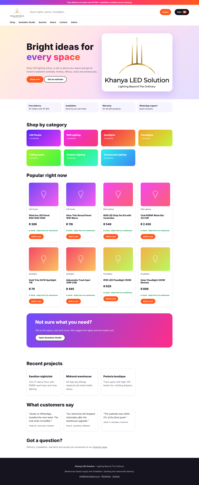
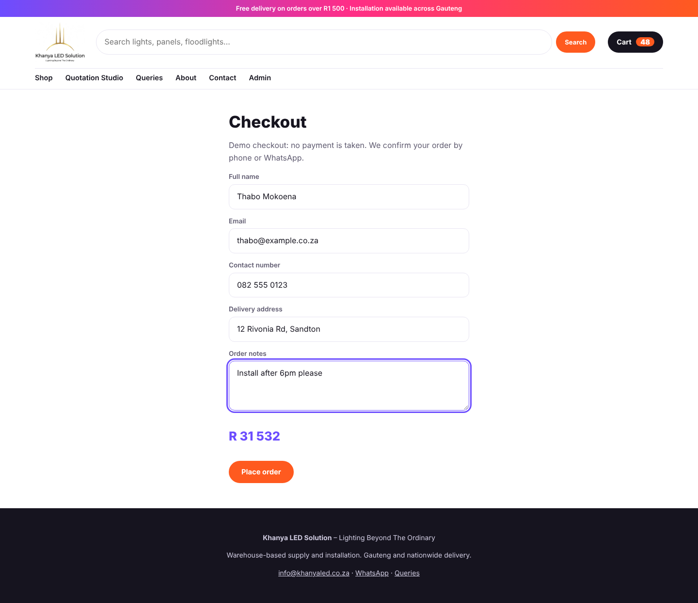
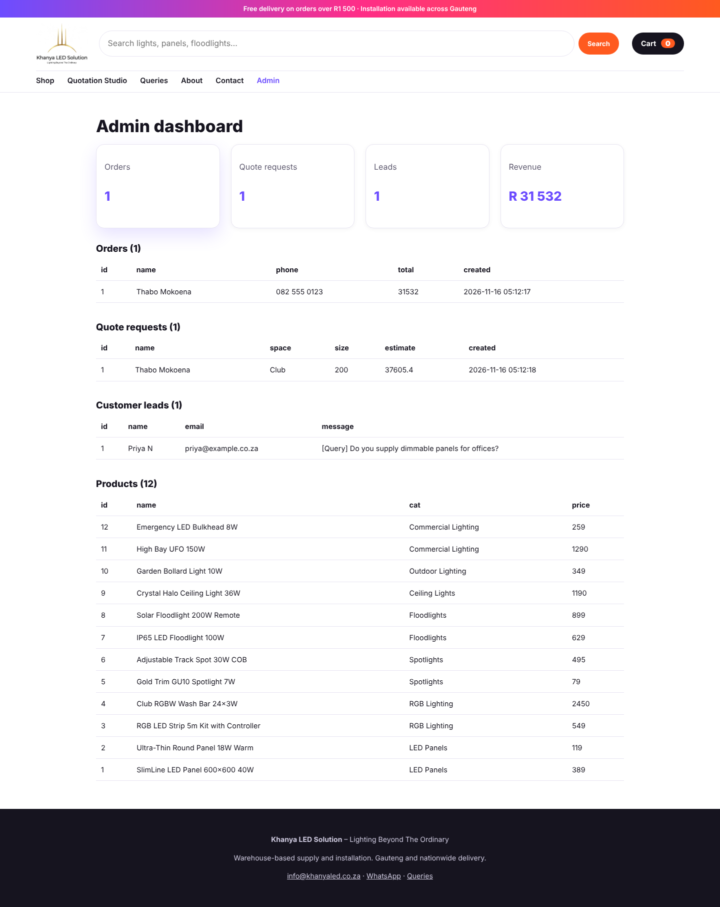
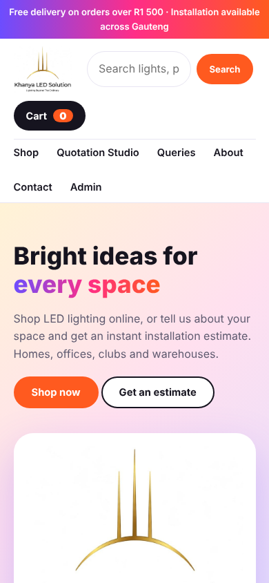

<<<<<<< HEAD
# 💡 Khanya LED Solution – E-Commerce


**Lighting Beyond The Ordinary**

## Overview
Khanya LED Solution is a digital lighting commerce and quotation platform. Residential and commercial customers can shop normally, or use the **Quotation Studio** to get lighting recommendations based on their space, atmosphere and installation needs.

## The Problem
Khanya LED Solution operates from a warehouse with no walk-in store. The business relied on word of mouth, quotes and sales were handled manually over WhatsApp and phone, customers waited for pricing, and larger online competitors took potential customers.

## The Solution
The platform makes Khanya digital-first. Customers can browse and search products, view categories, request quotations, get installation estimates, place orders and ask questions online.

## Key Feature: Quotation Studio
1. Select a space (Home, Office, Store, Mall, Club, Warehouse)
2. Enter the size (e.g. 200 m²) and location
3. Choose the atmosphere (Luxury, Warm & Cozy, Bright & Clean, Modern, Party)
4. Installation required or supply only
5. Receive product recommendations, a bundle, an installation estimate and a total estimate

Example: Club, 200 m², Party Atmosphere, Sandton, installation required returns a bundle of RGBW wash bars, LED panels and spotlights with an estimated total of about R 37 600.

## Screenshots
| Home | Product catalog |
|---|---|
|  |  |
| **Product details** | **Quotation Studio** |
|  |  |
| **Shopping cart** | **Checkout (demo)** |
|  |  |
| **Queries** | **Admin dashboard** |
|  |  |

Mobile: 

## Features
**Customers:** browse, search and filter products; cart; demo checkout; Quotation Studio; queries and contact forms.
**Business:** every quote request, order and enquiry is stored; the admin dashboard shows orders, quote requests, leads, products and revenue.

## System Workflow
Visit website → Browse products or open Quotation Studio → Enter project details → Receive recommendations and estimate → Add to cart or request quote → Admin reviews → Approval → Installation or delivery

## Tech Stack (this version)
| Layer | Technology |
|---|---|
| Front end | HTML, CSS, vanilla JavaScript (no build step) |
| Backend | PHP 8 |
| Database | SQLite (`database/khanya.db`, auto-created) |

## Project Structure
```
khanya-led-platform/
├── index.html           page shell, header, footer
├── css/style.css        theme and layout
├── js/app.js            pages, cart, Quotation Studio logic
├── api/index.php        orders, quotes, leads, admin API
├── data/products.json   product catalogue (seeds the database)
├── database/schema.sql  tables
├── assets/              logo
└── screenshots/
```

## Installation
```bash
git clone https://github.com/CyberSindz/khanya-led-platform.git
cd khanya-led-platform
php -S localhost:8000
```
Open http://localhost:8000. PHP 8+ with `pdo_sqlite` is optional: without it the site runs in **demo mode** (see below). Set the admin password in `api/index.php` (`ADMIN_PASSWORD`) before going live.

## Demo mode and dummy data
- With PHP running, orders, quotes and questions are saved to the SQLite database and the admin dashboard reads them from it. On first run the database is filled with dummy orders, quotes and leads from `data/demo.json` (set `SEED_DEMO_DATA` to `false` in `api/index.php` for production).
- Without PHP, you can open `index.html` directly. The catalogue and admin dashboard use dummy data from `js/dummy-data.js`, and new orders, quotes and questions are kept in the browser and appear in the admin dashboard on that device only.
- `js/dummy-data.js` is generated from `data/products.json` and `data/demo.json`. After editing those files, update it too.
- Customers never see technical error details. Server errors go to the server log and the browser console.
- Demo admin password: `khanya-admin` (change it in `api/index.php` and `js/app.js`).

## Assumptions
- Quotations are estimates only; final pricing may change after site inspection.
- Installation cost varies by location and project complexity.
- Product availability may affect final quotations.

## Future Enhancements
AI recommendations, 3D and AR previews, payment gateway (PayFast), technician scheduling, inventory, CRM, order and project tracking, admin product editing, a Next.js + Supabase version.

## Author
Khanya LED Solution Lighting Platform, built to modernise lighting sales, quotations and customer engagement.

*Lighting Beyond The Ordinary*
=======
💡 Khanya LED Solution - Lighting Studio Platform


Lighting Beyond The Ordinary
A modern lighting commerce and quotation platform designed to help customers discover, purchase, and install lighting solutions for residential and commercial spaces.

📌 Project Overview
Khanya LED Solution is a warehouse-based lighting supply and installation company serving customers across Gauteng and South Africa.

The business operates without a physical retail store and historically relied on:

Word-of-mouth referrals
WhatsApp enquiries
Phone calls
Manual quotation processes
While this approach supported the business in its early stages, it limited market reach, slowed quotation processing, and created operational inefficiencies.

This platform was developed to digitize the customer journey and provide a centralized system where customers can browse products, request quotations, obtain installation estimates, and interact with the business online.

The solution combines traditional e-commerce functionality with a guided quotation experience tailored specifically for lighting projects.

🚨 Problem Statement
Before this platform was developed, Khanya LED Solution faced several business challenges.

Limited Online Presence
The company relied heavily on referrals and had limited visibility to potential customers searching for lighting suppliers and installers online.

Manual Sales Process
Most enquiries, quotations, and consultations were managed through WhatsApp and phone calls, resulting in:

Slow customer response times
Difficult enquiry tracking
Inconsistent quotation management
Limited scalability
No Physical Storefront
Because the business operates primarily from a warehouse, customers could not easily browse products before making purchasing decisions.

Time-Consuming Quotations
Many customers did not know which products they required and needed guidance before receiving a quotation.

Generating estimates often required multiple conversations, site visits, and manual calculations.

Lost Business Opportunities
Customers frequently chose larger competitors with stronger digital platforms and a more professional online presence.

✅ Proposed Solution
The Lighting Studio Platform transforms Khanya LED Solution into a digital-first business.

The platform enables customers to:

Browse products online
Search lighting categories
Compare lighting solutions
Add products to cart
Request quotations
Obtain installation estimates
Submit project requirements
Track project progress
By moving these processes online, the business can improve customer experience, generate qualified leads, and scale operations more effectively.

🌟 Core Feature: Quotation Studio
The Quotation Studio is the platform's primary value-added feature.

Many customers know the outcome they want but are unsure which products are required to achieve it.

Instead of forcing customers to browse hundreds of individual products, the platform guides them through a quotation process.

Customer Inputs
Space Type
Home
Office
Retail Store
Shopping Mall
Club
Warehouse
Commercial Property
Project Size
Example:

200m²
Desired Atmosphere
Luxury
Bright & Clean
Warm & Cozy
Modern
Party Atmosphere
Installation Requirements
Installation Required
Supply Only
Generated Results
Based on the information provided, the system generates:

Product recommendations
Suggested lighting bundles
Installation estimates
Estimated total project cost
Example
Customer Input:

Space: Club
Size: 200m²
Atmosphere: Party
Installation: Yes
Location: Sandton
System Recommendation:

Club Party Bundle

12 x LED Panels
20m RGB LED Strips
6 x Spotlights

Installation Estimate
Project Cost Estimate
This significantly reduces the time required to begin the quotation process.

🛒 Customer Features
Product Catalog
Customers can:

Browse products
Search products
Filter by category
View product details
Compare options
Available Categories
LED Panels
RGB Lighting
Spotlights
Floodlights
Ceiling Lights
Outdoor Lighting
Commercial Lighting
Shopping Cart
Customers can:

Add products to cart
Modify quantities
Remove products
View order summaries
Quotation Studio
Customers can:

Describe project requirements
Receive recommendations
Obtain installation estimates
Request official quotations
Order Tracking
Quote Requested
↓
Approved
↓
Preparing
↓
Installing / Delivering
↓
Completed
🏢 Business Features
Lead Generation
Every quotation request becomes a potential sales lead.

Customer Management
The system helps organize customer enquiries and project requests.

Product Management
Administrators can:

Add products
Update prices
Manage categories
Create bundles
Quotation Management
Administrators can:

Review requests
Process quotations
Update project status
🔧 Admin Dashboard
The administration dashboard allows the business to:

Monitor orders
View quotation requests
Track customer leads
Manage products
Monitor revenue
Track business performance
⚙️ System Workflow
Customer Visits Website
           │
           ▼
 Browse Products
        OR
 Open Quotation Studio
           │
           ▼
 Enter Project Requirements
           │
           ▼
 Receive Recommendations
           │
           ▼
 View Estimated Costs
           │
           ▼
 Add To Cart OR Request Quote
           │
           ▼
 Admin Reviews Request
           │
           ▼
 Project Approval
           │
           ▼
 Installation / Delivery
🏗 System Architecture
Customer
    │
    ▼
Next.js Frontend
    │
    ▼
Supabase Backend
    │
 ┌──┴─────────┐
 ▼            ▼
Products   Quotations
Orders     Users
🛠 Technology Stack
Frontend
Next.js
React
TypeScript
Tailwind CSS
Backend
Supabase
Database
PostgreSQL
Hosting
Vercel
📁 Repository Structure
khanya-led-platform/
│
├── app/
├── components/
├── public/
├── screenshots/
├── docs/
├── lib/
├── styles/
├── utils/
│
├── README.md
├── package.json
└── next.config.js
📸 Screenshots
Project screenshots can be found in the /screenshots directory.

Included screenshots demonstrate:

Home Page
Product Catalog
Shopping Experience
Quotation Studio
Admin Dashboard
Business Analytics
📈 Business Impact
This platform helps Khanya LED Solution:

✅ Expand beyond referral-based marketing

✅ Improve online visibility

✅ Reduce reliance on manual WhatsApp-based processes

✅ Generate qualified sales leads

✅ Improve customer experience

✅ Streamline quotation management

✅ Scale without a physical retail store

✅ Create a professional digital presence

📝 Assumptions
Quotations generated by the platform are estimates only.
Final pricing may change after site inspections.
Product availability may affect final recommendations.
Installation costs vary based on location and project complexity.
🚀 Future Enhancements
AI-powered lighting recommendations
AR lighting visualization
Online payment gateway integration
Customer accounts
Inventory management
Technician scheduling
CRM integrations
Project history tracking
💻 Installation
Clone the repository:

git clone https://github.com/YOUR_USERNAME/khanya-led-platform.git
Navigate to the project:

cd khanya-led-platform
Install dependencies:

npm install
Run the development server:

npm run dev
Open in your browser:

http://localhost:3000
👨‍💻 Author
Khanya LED Solution Lighting Studio Platform

Developed to modernize lighting sales, quotations, installation services, and customer engagement through a scalable digital solution.

Lighting Beyond The Ordinary
>>>>>>> aea1d8cd6120703b8ba0dcc63d8422d1e55995d5
