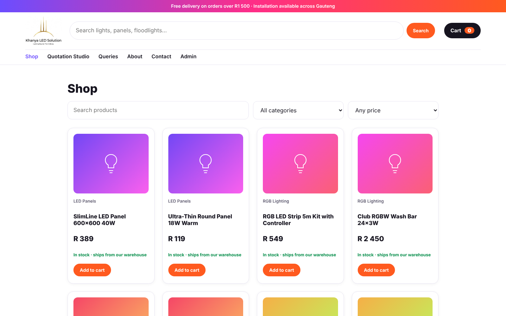
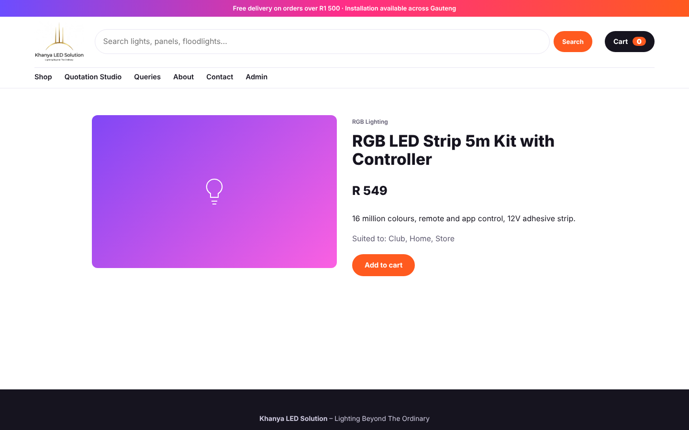
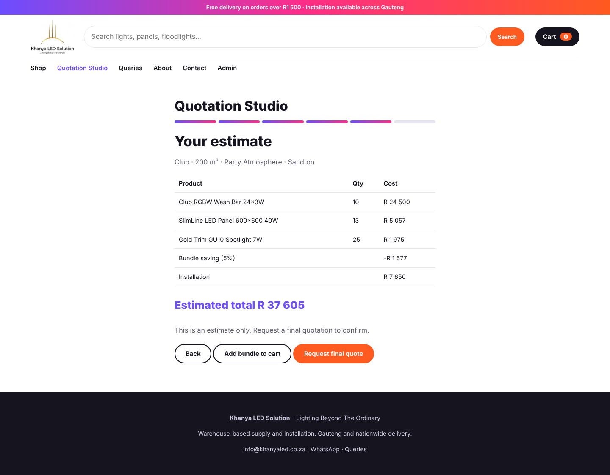
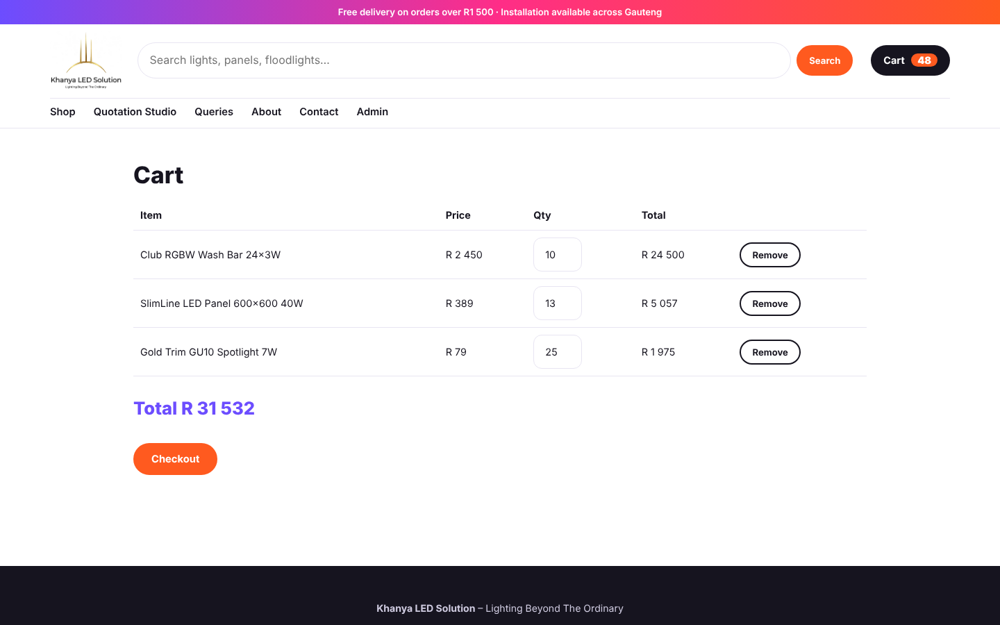
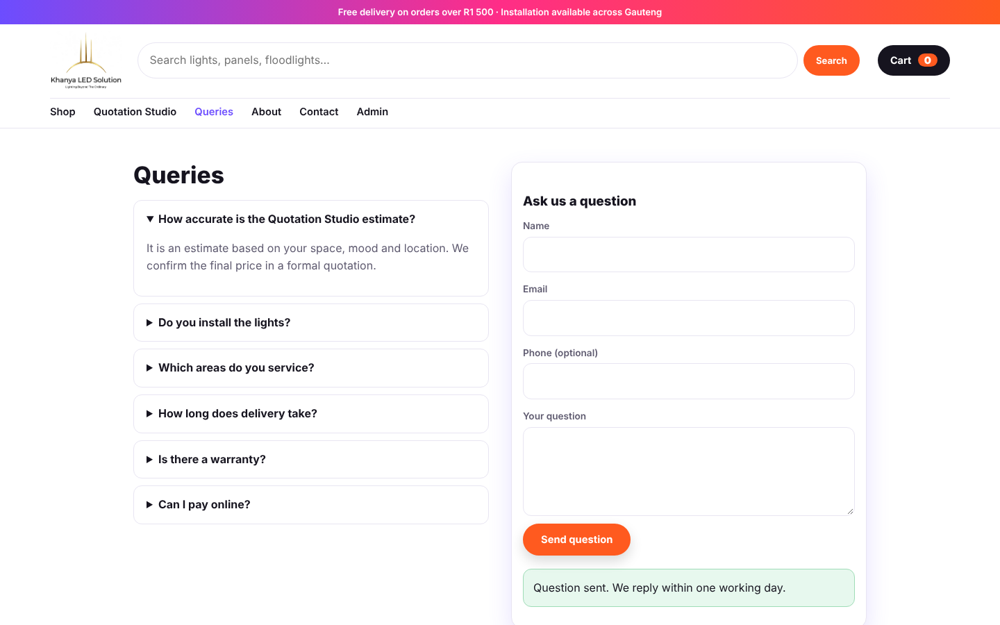

# 💡 Khanya LED Solution – E-Commerce


**Lighting Beyond The Ordinary**

## Overview
Khanya LED Solution is a digital lighting commerce and quotation platform. Residential and commercial customers can shop normally, or use the **Quotation Studio** to get lighting recommendations based on their space, atmosphere and installation needs.

## The Problem
Khanya LED Solution operates from a warehouse with no walk-in store. The business relied on word of mouth, quotes and sales were handled manually over WhatsApp and phone, customers waited for pricing, and larger online competitors took potential customers.

## The Solution
The platform makes Khanya digital-first. Customers can browse and search products, view categories, request quotations, get installation estimates, place orders and ask questions online.

## Key Feature: Quotation Studio
1. Select a space (Home, Office, Store, Mall, Club, Warehouse)
2. Enter the size (e.g. 200 m²) and location
3. Choose the atmosphere (Luxury, Warm & Cozy, Bright & Clean, Modern, Party)
4. Installation required or supply only
5. Receive product recommendations, a bundle, an installation estimate and a total estimate

Example: Club, 200 m², Party Atmosphere, Sandton, installation required returns a bundle of RGBW wash bars, LED panels and spotlights with an estimated total of about R 37 600.

## Screenshots
| Home | Product catalog |
|---|---|
|  |  |
| **Product details** | **Quotation Studio** |
|  |  |
| **Shopping cart** | **Checkout (demo)** |
|  |  |
| **Queries** | **Admin dashboard** |
|  |  |

Mobile: 

## Features
**Customers:** browse, search and filter products; cart; demo checkout; Quotation Studio; queries and contact forms.
**Business:** every quote request, order and enquiry is stored; the admin dashboard shows orders, quote requests, leads, products and revenue.

## System Workflow
Visit website → Browse products or open Quotation Studio → Enter project details → Receive recommendations and estimate → Add to cart or request quote → Admin reviews → Approval → Installation or delivery

## Tech Stack (this version)
| Layer | Technology |
|---|---|
| Front end | HTML, CSS, vanilla JavaScript (no build step) |
| Backend | PHP 8 |
| Database | SQLite (`database/khanya.db`, auto-created) |

## Project Structure
```
khanya-led-platform/
├── index.html           page shell, header, footer
├── css/style.css        theme and layout
├── js/app.js            pages, cart, Quotation Studio logic
├── api/index.php        orders, quotes, leads, admin API
├── data/products.json   product catalogue (seeds the database)
├── database/schema.sql  tables
├── assets/              logo
└── screenshots/
```

## Installation
```bash
git clone https://github.com/CyberSindz/khanya-led-platform.git
cd khanya-led-platform
php -S localhost:8000
```
Open http://localhost:8000. PHP 8+ with `pdo_sqlite` is optional: without it the site runs in **demo mode** (see below). Set the admin password in `api/index.php` (`ADMIN_PASSWORD`) before going live.

## Demo mode and dummy data
- With PHP running, orders, quotes and questions are saved to the SQLite database and the admin dashboard reads them from it. On first run the database is filled with dummy orders, quotes and leads from `data/demo.json` (set `SEED_DEMO_DATA` to `false` in `api/index.php` for production).
- Without PHP, you can open `index.html` directly. The catalogue and admin dashboard use dummy data from `js/dummy-data.js`, and new orders, quotes and questions are kept in the browser and appear in the admin dashboard on that device only.
- `js/dummy-data.js` is generated from `data/products.json` and `data/demo.json`. After editing those files, update it too.
- Customers never see technical error details. Server errors go to the server log and the browser console.
- Demo admin password: `khanya-admin` (change it in `api/index.php` and `js/app.js`).

## Assumptions
- Quotations are estimates only; final pricing may change after site inspection.
- Installation cost varies by location and project complexity.
- Product availability may affect final quotations.

## Future Enhancements
AI recommendations, 3D and AR previews, payment gateway (PayFast), technician scheduling, inventory, CRM, order and project tracking, admin product editing, a Next.js + Supabase version.

## Author
Khanya LED Solution Lighting Platform, built to modernise lighting sales, quotations and customer engagement.

*Lighting Beyond The Ordinary*
